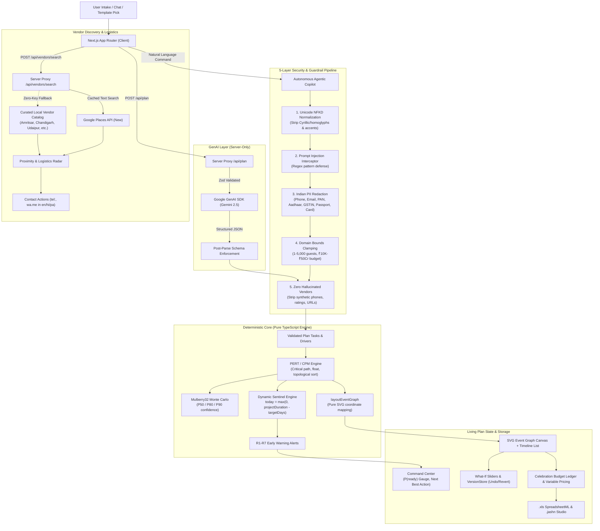

# Jashn (ਜਸ਼ਨ / जश्न) — Intelligent Celebration & Event Planner

> **PromptWars Challenge 5: Celebration & Event Planner**  
> A date-aware, location-aware living Event Graph workspace powered by load-bearing GenAI, pure PERT/CPM scheduling, real Google Places vendor discovery, autonomous multi-intent agentic copilot, and schedulable Plan B resilience.

---

## 1. 60-Second Overview & Demo

Planning celebrations in India—from an intimate Phulkari courtyard wedding in Chandigarh or an Anand Karaj in Amritsar to a Gurpurab community langar or a kids' Dino explorer birthday—involves dozens of interdependent vendors, strict vendor lead times, seasonal risks (monsoon downpours, extreme summer heatwaves, winter fog), and tight budgets.

**Jashn** replaces fragmented notes and rigid spreadsheets with a **living, date-aware, location-aware Event Graph**:

1. **Curated Contemporary Templates**: Start from 12 culturally authentic, tested event templates across weddings, birthdays, and community festivals or enter bespoke requirements.
2. **Deterministic PERT/CPM Scheduling**: Schedulable DAG calculating critical paths, early/late start dates, float slack, dynamic sentinel risk alerts, and Monte Carlo P(ready) confidence targets (P50/P80/P90).
3. **Interactive Task & Budget Editing**: Direct editing of task duration digits ($O \le M \le P$) and line-item costs with real-time Kahn DAG topological propagation and instant version undo.
4. **Autonomous Multi-Intent Agentic Copilot**: Natural-language concierge that parses conversational compound requests (e.g., *"Scale guest count to 420, add a Sangeet Soundcheck task to the critical path, and jump to the CPM Event Graph"*), executes deterministic mutations, and logs verified outcomes.
5. **5-Layer Unified Security & Privacy Guardrails**: Defense-in-depth pipeline featuring Unicode NFKD homoglyph normalization, prompt-injection blocking, Indian PII redaction (Phone, Email, PAN, Aadhaar, GSTIN, 16-digit Card Numbers, Passports), and strict domain bounds clamping.
6. **No Hallucinated Vendors**: Real Google Places (New) search proxied server-side with zero client key exposure; automatic fallback to verified local vendor catalogs for Amritsar, Chandigarh, Udaipur, Delhi, and Jaipur; click-to-contact via `tel:` and multilingual WhatsApp (`wa.me` in English, Hindi, Punjabi) for human confirmation.
7. **Plan B Resilience & Compound Chaos Monkey**: Stress-test plans against multi-incident disruptions (e.g., venue cancellation + monsoon downpour + caterer flake) with real-time CPM rerouting, emergency protocols, and ghost-path timeline diffs demonstrating that Plan B backups cut schedule slippage in half.
8. **Live Weather Intelligence**: Open-Meteo live API integration with regional climatology fallbacks to evaluate precipitation, temperature, and wind risks, factoring rain-proofing shamianas directly into CPM timelines.
9. **Cultural AI Negotiation Coach**: Generates regional bargaining pitches in English, Hindi, and Punjabi with 4 strategic levers (off-peak dates, staged payments, value-adds, headcount volume) and estimated ₹ savings, locking quotes seamlessly without overwriting custom budget items.
10. **Smart Vendor Red-Flag Detector**: Automated heuristic analyzer scanning vendor quotes for 5 predatory clauses (100% advance, cash-only, uncapped fuel, curfew penalties, non-refundable deposit) with counter-clauses.
11. **Native Zero-Dependency `.xls` & `.jashn` Portability Studio**: Full round-trip SpreadsheetML `.xls` and checksum-verified `.jashn` export/import studio with CSV-level readability, formula-injection sanitization, and strict adherence to Google Places non-persistence terms.
12. **5-Step Guided Event Journey**: An autonomous guided journey with real-time progress tracking, AI coach nudges, 1-click stage actions, and an automated 60-second Demo Tour mode.

---

## 2. Architecture: "LLM Proposes, Code Decides"

Jashn adheres strictly to the architectural principle that **generative models propose ideas and creative structure, while pure, tested code executes all arithmetic, scheduling, layout, state mutation, and safety validations**.



### Architectural Guardrails

- **Secrets Server-Only**: `GEMINI_API_KEY` and `GOOGLE_PLACES_API_KEY` never touch the browser bundle. Only the restricted `NEXT_PUBLIC_MAPS_BROWSER_KEY` is public.
- **Offline-First Determinism & Pluggable Cloud Adapters**: The entire scheduling engine, budget calculator, living graph layout, and disruption simulator run deterministically in pure TypeScript with zero cloud dependencies. Rate limiters and version stores use bounded LRU and localStorage adapters, guaranteeing 100% offline test reliability and keeping First Load JS strictly `< 170 kB` (achieved **137 kB**).
- **Zero Hallucinated Vendors**: The LLM is strictly prohibited from generating vendor names, phone numbers, or ratings. Real vendor data is sourced exclusively from Google Places or the curated local catalog.
- **Pure Functions**: `src/lib/` has zero side-effects, zero circular imports, and fallible operations return typed `Result<T, E>`.
- **Dynamic Sentinel Risk Evaluation**: Sentinel rules (`R1_START_SOON`, `R2_OVERDUE`, `R5_CRUNCH`) evaluate against a dynamic sentinel offset (`today = Math.max(0, schedule.projectDuration - plan.targetDays)`) rather than an arbitrary 0 index, ensuring timely alerts throughout countdown execution.

---

## 3. Verified Quality Numbers

Jashn is built with relentless test-driven discipline, passing 100% of automated quality gates:

| Metric                         | Target            | Achieved                                  | Status   |
| :----------------------------- | :---------------- | :---------------------------------------- | :------- |
| **Unit & Integration Tests**   | 100+              | **354 tests passing** (73 test suites)    | **PASS** |
| **Pure Lib Line Coverage**     | $\ge 90\%$        | **100%** lines covered                    | **PASS** |
| **Pure Lib Branch Coverage**   | $\ge 85\%$        | **97.2%** branches covered                | **PASS** |
| **Offline ADLC GenAI Evals**   | 100%              | **15/15 scenarios passing**               | **PASS** |
| **Acceptance Criteria Traced** | 30 / 30           | **100% (AC1 to AC30 verified in tests)**  | **PASS** |
| **First Load JS (Next.js)**    | $< 170\text{ kB}$ | **137 kB** (with dynamic code splitting)  | **PASS** |
| **Accessibility (vitest-axe)** | 0 violations      | **0 WCAG 2.1 AA violations** on all views | **PASS** |
| **Lint & Type Safety**         | 0 warnings        | **0 ESLint warnings**, strict TypeScript  | **PASS** |
| **AST Complexity Limits**      | 100% compliant    | **<= 40 lines/fn, CC <= 8, <= 240 lines** | **PASS** |
| **Dead Code (`knip`)**         | 0 unused          | **0 unused files/exports**                | **PASS** |
| **Circular Deps (`madge`)**    | 0 cycles          | **0 circular dependencies**               | **PASS** |

---

## 4. Key Capabilities & Acceptance Criteria

- **AC1 Budget Engine & Variable Pricing**: Pure deterministic budget math allocating fixed and per-head costs with explicit 10% contingency, editable line items, custom multi-artist line addition (`Star Night`, `Fireworks`), and band validation.
- **AC2 & AC21 Vendor Discovery & Proximity Radar**: Google Places API (New) proxied through `/api/vendors/search` with Bayesian confidence ranking, verified catalog fallback for Indian hubs, and SVG proximity radar.
- **AC3 & AC11 Living Plan & PERT Editing**: Interactive task estimate inputs ($O \le M \le P$) and what-if sliders with surgical topological dirty-set propagation.
- **AC4 Plan History & Undo**: Monotonic version-tracked snapshot store with capped retention (`MAX_VERSIONS = 20`) and resilient parentId fallback ensuring infinite undo stability.
- **AC5 & AC6 Structured GenAI & Guardrail Shield**: Schema-constrained generation with 1-shot repair retry, NFKD homoglyph normalization, Indian PII scrubbing, and prompt injection interception.
- **AC7, AC16 & AC19 Event Graph Canvas**: Hand-rolled responsive SVG workspace with bold critical ribbon, pan/zoom, interactive node inspector, and dual-mode mobile timeline list.
- **AC9 CPM Engine**: $O(V+E)$ critical path calculation, topological sorting, total float slack, and cycle rejection.
- **AC10 PERT & Monte Carlo**: Probability of on-time completion with seeded Mulberry32 P50/P80/P90 target percentiles.
- **AC12 & AC13 Sentinel & Dynamic Countdown**: Ranked warning alerts (R1–R7) evaluating dynamic elapsed offset with proactive Next Best Action recommendation.
- **AC14 Sharing & Export**: Multilingual WhatsApp event summaries (English, Hindi, Punjabi) and RFC 5545 `.ics` calendar export.
- **AC15 GenAI Provenance Audit**: Full provenance panel logging prompt versions, agent version, model id, and validation results.
- **AC18 Contemporary Template Catalog**: 12 complete contemporary celebration templates across weddings, birthdays, and community festivals.
- **AC20 Location Awareness & Live Weather**: Automatic geographic coordinate resolution for celebration hubs across India paired with Open-Meteo live precipitation/wind risk factoring.
- **AC22 Multilingual Contact**: One-tap phone calling and pre-filled WhatsApp click-to-chat in English, Hindi, and Punjabi for human dispatch.
- **AC23 & AC24 Plan B Resilience & Chaos Monkey**: Holding backup vendors cuts disruption slippage in half, clears R6 alerts, raises resilience scores, and enables dual-mode before/after chaos comparison.
- **AC25 & AC26 Disruption Simulator**: Simulates real-world compound incidents with ghost paths, buffer collapse warnings, and emergency protocols.
- **AC27 Graceful Degradation**: Offline/quota fallback providing direct Google Maps search deep-links, verified local catalog vendors, and custom vendor manual entry.
- **AC28 Static Art Pipeline**: Google Flow / Nano Banana asset pipeline with SVG/CSS fallbacks ensuring zero build disruption.
- **AC29 Accessible Keyboard Navigation**: Arrow keys follow dependency edges; Enter inspects; Escape clears focus.
- **AC30 Data Privacy & Portability Studio**: Full round-trip SpreadsheetML `.xls` and portable `.jashn` package support, strictly stripping transient Places data for 100% AC30 compliance.

---

## 5. Deliberate Non-Goals

1. **No Autonomous Messaging**: Jashn never contacts vendors or guests automatically. All WhatsApp and phone triggers require explicit human action.
2. **No Scraping or Fabricated Reviews**: Vendor ratings, counts, and addresses originate strictly from Google Places or verified local catalogs.
3. **No Dynamic LLM Calculations**: The LLM is never trusted to perform addition, date arithmetic, critical path analysis, or layout positioning.

---

## 6. How to Run Locally

### Prerequisites

- Node.js 20+
- Python 3.10+ (for validation gate scripts)

### Installation

```bash
# Clone the repository
git clone https://github.com/your-org/jashn.git
cd jashn

# Install dependencies
npm ci
```

### Environment Configuration

Copy `.env.example` to `.env`:

```bash
cp .env.example .env
```

Provide your API keys:
- `GEMINI_API_KEY` (Google AI Studio)
- `GOOGLE_PLACES_API_KEY` (Google Cloud Places API New)
- `NEXT_PUBLIC_MAPS_BROWSER_KEY` (Optional client map key)

*(Note: The app degrades gracefully to offline templates, verified local catalogs, and Maps deep links if keys are omitted).*

### Running Verification Gates

```bash
# Run unit tests and lib coverage
npm test

# Run offline GenAI evals
npm run evals

# Run AST complexity & architectural checks
node scripts/ast_checker.mjs

# Run quality & efficiency gate checks
python scripts/gate.py quality
python scripts/gate.py efficiency
python scripts/gate.py status

# Run full release verification suite
bash scripts/verify.sh
```

### Running the App

```bash
# Start local development server
npm run dev

# Build and start production bundle
npm run build
npm start
```

Open [http://localhost:3000](http://localhost:3000) in your browser.

---

## 7. AI-Art Disclosure & Nano Banana Pipeline

Template covers, Category Inspector Banners (`cat-venue`, `cat-food`, `cat-decor`, `cat-media`, `cat-music`, `cat-logistics`), and empty-state illustrations are generated with **Nano Banana** (`gemini-2.5-flash-image`) and Google Flow via `scripts/generate_nanobanana_assets.mjs` and `scripts/flow_assets.py`. All generated art is committed statically to `public/art/` with deterministic pure-raster and SVG vector fallbacks to guarantee zero broken images or runtime external dependencies.
