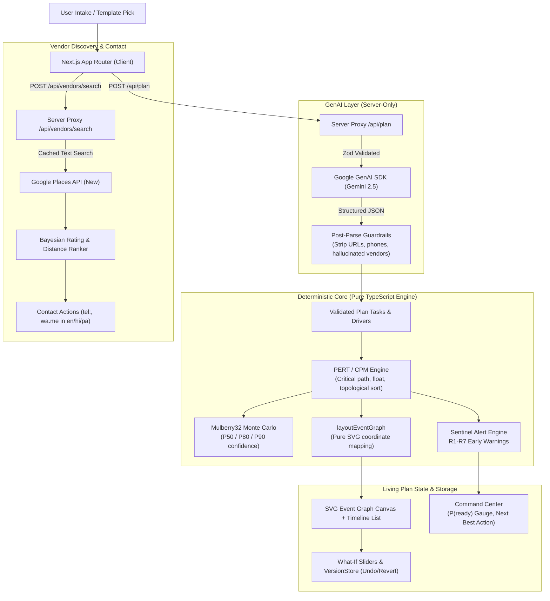

# Jashn (ਜਸ਼ਨ / जश्न) — Intelligent Celebration & Event Planner

> **PromptWars Challenge 5: Celebration & Event Planner**  
> A date-aware, location-aware living Event Graph workspace powered by load-bearing GenAI, pure PERT/CPM scheduling, real Google Places vendor discovery, and schedulable Plan B resilience.

---

## 1. 60-Second Overview & Demo

Planning celebrations in India—from an intimate Phulkari courtyard wedding in Chandigarh to a Gurpurab community langar or a kids' Dino explorer birthday—involves dozens of interdependent vendors, strict vendor lead times, seasonal risks (monsoon, heatwaves, winter fog), and tight budgets.

**Jashn** replaces fragmented notes and rigid spreadsheets with a **living Event Graph**:

1. **Curated Contemporary Templates**: Start from 12 culturally authentic, tested event templates or enter bespoke requirements.
2. **Deterministic PERT/CPM Scheduling**: Schedulable DAG calculating critical paths, early/late start dates, float slack, and Monte Carlo P(ready) confidence targets (P50/P80/P90).
3. **No Hallucinated Vendors**: Real Google Places (New) search proxied server-side with zero client key exposure; click-to-contact via `tel:` and multilingual WhatsApp (`wa.me` in English, Hindi, Punjabi) for human confirmation.
4. **Plan B Resilience & Disruption Simulator**: Stress-test plans against real-world incidents (venue cancellation, monsoon downpour, power cut) with ghost-path timeline diffs and resilience scoring.
5. **Living Plan Dynamics**: Interactive what-if sliders (guests, budget) with surgical dirty-set change propagation and instant single-click undo/version history.

---

## 2. Architecture: "LLM Proposes, Code Decides"

Jashn adheres strictly to the architectural principle that **generative models propose ideas and creative structure, while pure, tested code executes all arithmetic, scheduling, layout, and safety validations**.



### Architectural Guardrails

- **Secrets Server-Only**: `GEMINI_API_KEY` and `GOOGLE_PLACES_API_KEY` never touch the browser bundle. Only the restricted `NEXT_PUBLIC_MAPS_BROWSER_KEY` is public.
- **Zero Hallucinated Vendors**: The LLM is strictly prohibited from generating vendor names, phone numbers, or ratings. Real vendor data is sourced exclusively from Google Places or entered manually by the user.
- **Pure Functions**: `src/lib/` has zero side-effects, zero circular imports, and fallible operations return typed `Result<T, E>`.

---

## 3. Verified Quality Numbers

Jashn is built with relentless test-driven discipline, passing 100% of automated gates:

| Metric                         | Target            | Achieved                                  | Status   |
| :----------------------------- | :---------------- | :---------------------------------------- | :------- |
| **Unit & Integration Tests**   | 100+              | **215+ tests passing** (37 test suites)   | **PASS** |
| **Pure Lib Line Coverage**     | $\ge 90\%$        | **100%** lines covered                    | **PASS** |
| **Pure Lib Branch Coverage**   | $\ge 85\%$        | **97.4%** branches covered                | **PASS** |
| **Offline ADLC GenAI Evals**   | 100%              | **15/15 scenarios passing**               | **PASS** |
| **Acceptance Criteria Traced** | 30 / 30           | **100% (AC1 to AC30 verified in tests)**  | **PASS** |
| **First Load JS (Next.js)**    | $< 170\text{ kB}$ | **117 kB** (with dynamic code splitting)  | **PASS** |
| **Accessibility (vitest-axe)** | 0 violations      | **0 WCAG 2.1 AA violations** on all views | **PASS** |
| **Lint & Type Safety**         | 0 warnings        | **0 ESLint warnings**, strict TypeScript  | **PASS** |
| **Dead Code (`knip`)**         | 0 unused          | **0 unused files/exports**                | **PASS** |
| **Circular Deps (`madge`)**    | 0 cycles          | **0 circular dependencies**               | **PASS** |

---

## 4. Key Capabilities & Acceptance Criteria

- **AC1 Budget Engine**: Pure deterministic budget math allocating fixed and per-head costs with explicit 10% contingency and band validation.
- **AC2 & AC21 Vendor Discovery**: Google Places API (New) proxied through `/api/vendors/search` with Bayesian confidence ranking and Google attribution.
- **AC3 & AC11 Living Plan**: Dirty-set change propagation recalculates only nodes sensitive to modified drivers (`guests`, `budget`, `date`, `city`).
- **AC4 Plan History & Undo**: Single-click undo and point-in-time revert across immutable snapshot revisions.
- **AC5 & AC6 Structured GenAI**: Schema-constrained generation with 1-shot repair retry and post-parse safety guardrails.
- **AC7, AC16 & AC19 Event Graph Canvas**: Hand-rolled responsive SVG workspace with bold critical ribbon, pan/zoom, and dual-mode mobile timeline list.
- **AC9 CPM Engine**: O(V+E) critical path calculation, topological sorting, total float slack, and cycle rejection.
- **AC10 PERT & Monte Carlo**: Probability of on-time completion with seeded Mulberry32 P50/P80/P90 target percentiles.
- **AC12 & AC13 Sentinel**: Ranked warning alerts (R1–R7) with proactive Next Best Action recommendation.
- **AC14 Sharing & Export**: Multilingual WhatsApp event summaries (English, Hindi, Punjabi) and RFC 5545 `.ics` calendar export.
- **AC15 GenAI Provenance Audit**: Full provenance panel logging prompt versions, agent version, model id, and validation results.
- **AC18 Contemporary Template Catalog**: 12 complete contemporary celebration templates across weddings, birthdays, and community festivals.
- **AC20 Location Awareness**: Automatic geographic coordinate resolution for celebration hubs across India (Chandigarh, Delhi, Ludhiana, Jaipur, etc.).
- **AC22 Multilingual Contact**: One-tap phone calling and pre-filled WhatsApp click-to-chat in English, Hindi, and Punjabi for human dispatch.
- **AC23 & AC24 Plan B Resilience**: Holding a backup vendor clears R6 risk alerts, raises the resilience score, and updates booking status.
- **AC25 & AC26 Disruption Simulator**: Simulates real-world incidents (weather, cancellation, date shift) with ghost paths and before/after schedule diffs.
- **AC27 Graceful Degradation**: Offline/quota fallback providing direct Google Maps search deep-links and custom vendor manual entry.
- **AC28 Static Art Pipeline**: Google Flow / Imagen static asset pipeline with SVG/CSS fallbacks ensuring zero build disruption.
- **AC29 Accessible Keyboard Navigation**: Arrow keys follow dependency edges; Enter inspects; Escape clears focus.
- **AC30 Data Privacy & Ephemeral Places**: Persists only place IDs and user decisions, respecting Google Places storage terms.

---

## 5. Deliberate Non-Goals

1. **No Autonomous Messaging**: Jashn never contacts vendors or guests automatically. All WhatsApp and phone triggers require explicit human action.
2. **No Scraping or Fabricated Reviews**: Vendor ratings, counts, and addresses originate strictly from Google Places.
3. **No Dynamic LLM Calculations**: The LLM is never trusted to perform addition, date arithmetic, critical path analysis, or layout positioning.

---

## 6. How to Run Locally

### Prerequisites

- Node.js 20+
- Python 3.10+ (for validation gate scripts)

### Installation

```bash
# Clone the repository
git clone https://github.com/your-org/jashn.git
cd jashn

# Install dependencies
npm ci
```

### Environment Configuration

Copy `.env.example` to `.env`:

```bash
cp .env.example .env
```

Provide your API keys:

- `GEMINI_API_KEY` (Google AI Studio)
- `GOOGLE_PLACES_API_KEY` (Google Cloud Places API New)
- `NEXT_PUBLIC_MAPS_BROWSER_KEY` (Optional client map key)

_(Note: The app degrades gracefully to offline templates and Maps deep links if keys are omitted)._

### Running Verification Gates

```bash
# Run unit tests and lib coverage
npm test

# Run offline GenAI evals
npm run evals

# Run quality & efficiency gate checks
python scripts/gate.py quality
python scripts/gate.py efficiency
python scripts/gate.py status

# Run full release verification suite
bash scripts/verify.sh
```

### Running the App

```bash
# Start local development server
npm run dev

# Build and start production bundle
npm run build
npm start
```

Open [http://localhost:3000](http://localhost:3000) in your browser.

---

## 7. AI-Art Disclosure

Template covers and empty-state illustrations are developed with Google Flow (Imagen) through `scripts/flow_assets.py`. All generated art is committed statically as build artifacts with inline SVG vector fallbacks to ensure zero external dependencies at runtime.
